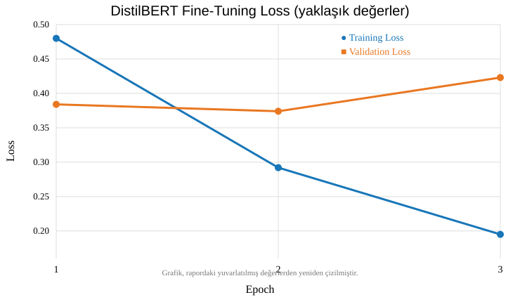
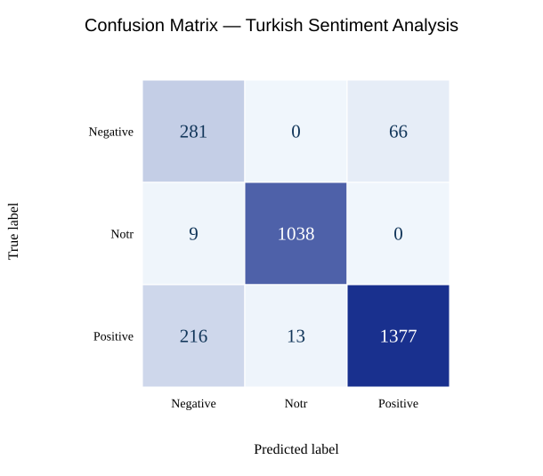

# DistilBERT ile Türkçe Duygu Analizi
## İnce Ayar (Fine-Tuning) ve Performans Değerlendirmesi

**HİTİT ÜNİVERSİTESİ — DOĞAL DİL İŞLEME**  
**Ders öğretim elemanı:** Dr. Yusuf ALACA  
**Öğrenci:** Omar Gouda  
**Tarih:** Ekim 2026

| Proje bilgisi | Açıklama |
|---|---|
| Ders | Doğal Dil İşleme |
| Görev | Üç sınıflı metin sınıflandırma |
| Model | distilbert-base-multilingual-cased |
| Platform | Google Colab / NVIDIA Tesla T4 |

## Özet

Bu çalışmada Türkçe kullanıcı yorumlarının olumlu (Positive), nötr (Notr) ve olumsuz (Negative) olarak sınıflandırılması amaçlanmıştır. Çok dilli DistilBERT modeli, etiketli Türkçe yorumlarla ince ayardan geçirilmiştir. Eğitim için 4.800, doğrulama için 1.200 örnek kullanılmış; bağımsız test bölümünden seçilen 3.000 örnek üzerinde **%89,87 doğruluk** ve **%85,05 makro F1** elde edilmiştir. Sonuçlar, modelin özellikle nötr yorumlarda başarılı olduğunu, olumlu ve olumsuz sınıflar arasında ise bazı karışıklıklar bulunduğunu göstermiştir.

**Anahtar kelimeler:** Doğal dil işleme, duygu analizi, DistilBERT, ince ayar, Türkçe metin sınıflandırma.

## 1. Giriş ve Projenin Amacı

Duygu analizi, bir metinde ifade edilen görüşün olumlu, olumsuz veya nötr olup olmadığını belirleyen doğal dil işleme uygulamalarından biridir. E-ticaret yorumları, müşteri geri bildirimleri ve sosyal medya metinleri bu yöntemin yaygın kullanım alanlarıdır.

Bu projenin amacı, önceden eğitilmiş bir dil modelini Türkçe yorumların üç sınıfa ayrılması için uyarlamak ve ince ayar sürecinin performansını sayısal ölçütler ve grafiklerle incelemektir. Çalışma bir ders ödevi kapsamında gerçekleştirilmiştir; büyük ölçekli bir üretim sistemi hedeflenmemiştir.

## 2. Veri Kümesi

Hugging Face üzerinde yayımlanan [winvoker/turkish-sentiment-analysis-dataset](https://huggingface.co/datasets/winvoker/turkish-sentiment-analysis-dataset) veri kümesi kullanılmıştır. Veri kümesinde `text` (yorum metni), `label` (duygu etiketi) ve `dataset` (kaynak) alanları bulunmaktadır. Eğitim bölümünde 440.679, test bölümünde 48.965 kayıt vardır.

| Etiket | Orijinal eğitim verisi | Oran |
|---|---:|---:|
| Positive | 235.949 | %53,5 |
| Notr | 153.825 | %34,9 |
| Negative | 50.905 | %11,5 |
| **Toplam** | **440.679** | **%100** |

Orijinal eğitim verisinde sınıflar dengesizdir. Deneyi daha kısa sürede yürütmek ve her sınıfın öğrenme sürecinde eşit temsil edilmesini sağlamak için her etiketten rastgele 2.000 örnek alınmıştır (`random_state=42`). Bu 6.000 örneğin %80’i eğitim, %20’si doğrulama için ayrılmıştır. Bölme sırasında sınıf oranları korunmuştur (stratified split).

| Bölüm | Örnek sayısı | Açıklama |
|---|---:|---|
| Eğitim | 4.800 | Her sınıftan 1.600 |
| Doğrulama | 1.200 | Her sınıftan 400 |
| Test | 3.000 | Orijinal test bölümünden tabakalı örneklem |

Test örnekleri model eğitimi veya en iyi modelin seçimi için kullanılmamıştır. Orijinal test dağılımı dengesiz olduğundan doğruluğun yanında makro F1 de raporlanmıştır.

## 3. Yöntem ve İnce Ayar Süreci

### 3.1. Model seçimi

`distilbert/distilbert-base-multilingual-cased` modeli tercih edilmiştir. DistilBERT, BERT tabanlı daha hafif bir Transformer mimarisidir ve Türkçe dahil çok sayıda dilde kullanılabilir. Önceden öğrenilmiş dil temsilleri, üç sınıflı duygu sınıflandırma görevine aktarılmıştır.

### 3.2. Metinlerin hazırlanması

Metinler `AutoTokenizer` ile tokenlara dönüştürülmüştür. Girdiler en fazla 128 token olacak şekilde kesilmiş, değişken uzunluklu örnekler eğitim sırasında `DataCollatorWithPadding` ile uygun uzunlukta doldurulmuştur. Etiketler **Negative=0**, **Notr=1** ve **Positive=2** olarak sayısallaştırılmıştır.

### 3.3. Eğitim ayarları

| Parametre | Değer |
|---|---|
| Epoch | 3 |
| Learning rate | 2e-5 |
| Eğitim batch size | 8 |
| Doğrulama batch size | 16 |
| Warmup steps | 60 |
| Weight decay | 0,01 |
| Maksimum token | 128 |
| Precision | FP16 |
| Rastgele tohum | 42 |
| Model seçimi | En yüksek doğrulama makro F1 |

Hugging Face `Trainer` kullanılarak üç epoch boyunca eğitim gerçekleştirilmiştir. Her epoch sonunda doğrulama yapılmış, doğrulama makro F1 değerine göre en iyi kontrol noktası seçilmiştir (`load_best_model_at_end=True`). Eğitim kaybı ve doğrulama kaybı kaydedilmiştir.

### 3.4. Deney akışı

Veri kümesinin yüklenmesi → Sınıf dengeli örneklem seçimi → Eğitim/doğrulama ayrımı → Tokenizasyon → DistilBERT ince ayarı → Doğrulama ve en iyi model seçimi → Ayrı test kümesiyle değerlendirme → Yeni cümlelerle tahmin.

## 4. Eğitim Eğrileri ve Yorum

*Şekil 1. Üç epoch boyunca eğitim ve doğrulama kaybı.*

Eğitim kaybı yaklaşık 0,48’den 0,20’ye düşmüştür. Bu durum, modelin eğitim örneklerini giderek daha iyi öğrendiğini göstermektedir. Doğrulama kaybı ilk iki epoch arasında hafifçe azalırken üçüncü epoch sonunda yaklaşık 0,42’ye yükselmiştir.

Eğitim kaybı düşmeye devam ederken doğrulama kaybının yükselmesi, aşırı öğrenme (overfitting) başlangıcına işaret edebilir. Bu nedenle yalnızca son epoch yerine doğrulama makro F1 ölçütüne göre en iyi modelin saklanması tercih edilmiştir. Grafik tek başına en iyi epochu kesin olarak belirlemez; bunun için epoch bazındaki F1 kayıtları incelenmelidir.

## 5. Test Performansı

İnce ayardan sonra seçilen model, orijinal test bölümünden sınıf oranları korunarak seçilen 3.000 yorum üzerinde değerlendirilmiştir.

| Ölçüt | Sonuç |
|---|---:|
| Accuracy (Doğruluk) | **%89,87** |
| Macro F1 | **%85,05** |
| Weighted F1 | **%90,51** |

### 5.1. Sınıf bazında sonuçlar

| Sınıf | Precision | Recall | F1 | Destek |
|---|---:|---:|---:|---:|
| Negative | %55,53 | %80,98 | %65,89 | 347 |
| Notr | %98,76 | %99,14 | %98,95 | 1.047 |
| Positive | %95,43 | %85,74 | %90,32 | 1.606 |

Nötr sınıfı en yüksek F1 değerine sahiptir. Negatif sınıfında recall %80,98 olmasına rağmen precision %55,53’tür; başka sınıflara ait bazı yorumlar yanlışlıkla negatif olarak etiketlenmiştir. Bu nedenle genel doğruluk yüksek olsa da sınıflar arasında eşit performans yoktur.

*Şekil 2. 3.000 test yorumu için karışıklık matrisi. Satırlar gerçek, sütunlar tahmin edilen etiketlerdir.*

Matristen görüldüğü gibi 347 negatif yorumun 281’i doğru tahmin edilmiş, 66’sı pozitif olarak sınıflandırılmıştır. 1.047 nötr yorumun 1.038’i doğru sınıflandırılmıştır. 1.606 pozitif yorumun 1.377’si doğru tahmin edilirken 216’sı negatif, 13’ü nötr olarak tahmin edilmiştir.

## 6. Yeni Cümlelerle Uygulama

Model, test raporuna ek olarak üç kısa Türkçe cümle üzerinde denenmiştir. Aşağıdaki yüzdeler modelin ilgili tahmine atadığı olasılıklardır; modelin genel doğruluk oranı olarak yorumlanmamalıdır.

| Örnek cümle | Tahmin | Model olasılığı |
|---|---|---:|
| Bu ürünü çok beğendim, harika çalışıyor. | Positive | %98,61 |
| Ürün çok kötü, hiç memnun kalmadım. | Negative | %99,09 |
| Paket bugün teslim edildi. | Notr | %99,93 |

Üç örnek de beklenen duygu sınıfına atanmıştır. Ancak bu küçük gösterim, modelin tüm yeni metinlerde aynı doğrulukla çalışacağını kanıtlamaz; esas performans ölçümü bağımsız test kümesine dayanmaktadır.

## 7. Sonuç ve Sınırlılıklar

Bu ödevde çok dilli DistilBERT modeli Türkçe duygu analizi için başarıyla ince ayardan geçirilmiştir. Dengeli 4.800 eğitim örneği ve 1.200 doğrulama örneğiyle üç epoch eğitim yapılmış; 3.000 test örneğinde %89,87 doğruluk ve %85,05 makro F1 elde edilmiştir. Eğitim ve doğrulama kaybı grafikleri ile karışıklık matrisi modelin güçlü ve zayıf yönlerini görünür kılmıştır.

Başlıca sınırlılıklar şunlardır: eğitim için tam veri kümesi yerine küçük ve dengeli bir alt küme kullanılması, üçüncü epochta doğrulama kaybının artması ve pozitif-negatif sınıflar arasında karışıklık bulunması. Gelecekte daha fazla veri, farklı öğrenme oranları, erken durdurma ve sınıf bazlı hata analizi denenebilir.

## 8. Kaynaklar

1. Hugging Face. [winvoker/turkish-sentiment-analysis-dataset](https://huggingface.co/datasets/winvoker/turkish-sentiment-analysis-dataset).
2. Hugging Face. [distilbert/distilbert-base-multilingual-cased](https://huggingface.co/distilbert/distilbert-base-multilingual-cased).
3. Sanh, V. ve diğerleri (2019). *DistilBERT, a distilled version of BERT: smaller, faster, cheaper and lighter*. arXiv:1910.01108.
4. [Hugging Face Transformers Documentation — Trainer](https://huggingface.co/docs/transformers/main_classes/trainer).
